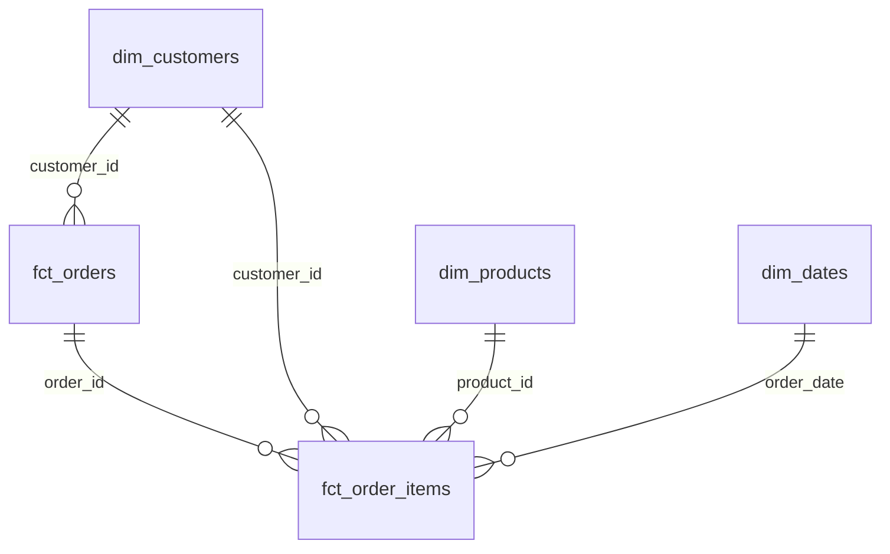
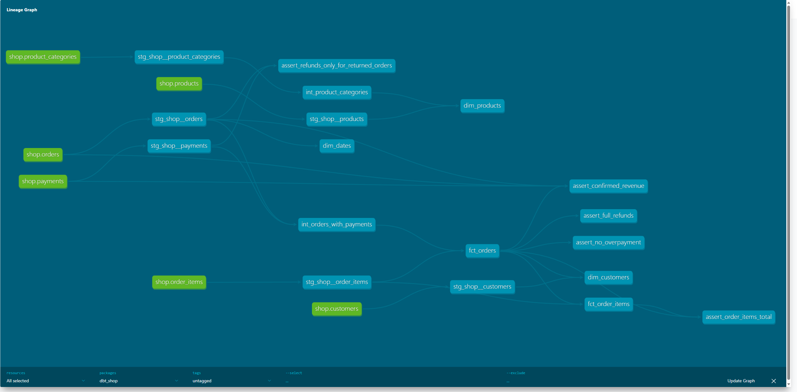

# store_hse

Проект с аналитическими витринами интернет-магазина на dbt и Greenplum.

## Запуск

Для работы нужны Docker Desktop и Git.

Запуск баз данных и загрузчика:

```bash
docker compose up -d
```

Проверка загрузки исходных данных:

```bash
docker compose logs loader
```

Установка зависимостей dbt:

```bash
docker compose --profile tools run --rm dbt deps
```

Сборка моделей и запуск тестов:

```bash
docker compose --profile tools run --rm dbt build
```

Генерация документации:

```bash
docker compose --profile tools run --rm dbt docs generate
```

## Структура проекта

Исходные данные интернет-магазина находятся в PostgreSQL. Сервис loader переносит их в Greenplum, в базу dwh и схему raw.

Модели dbt разделены на три слоя:

- staging: подготовка данных из исходных таблиц;
- intermediate: объединение таблиц и промежуточные расчёты;
- marts: готовые таблицы для аналитики.

## Модель данных

В проекте используется схема «звезда» с двумя таблицами фактов и тремя измерениями.



| Витрина | Одна строка | Для чего используется |
|---|---|---|
| fct_orders | Один заказ | Анализ выручки, оплат и возвратов |
| fct_order_items | Товар в заказе | Анализ продаж по товарам и брендам |
| dim_customers | Один клиент | Анализ покупателей, городов и каналов привлечения |
| dim_products | Один товар | Анализ категорий товаров |
| dim_dates | Один день | Анализ продаж по датам |

## Хранение в Greenplum

| Витрина | Распределение | Хранение | Причина выбора |
|---|---|---|---|
| fct_orders | BY (order_id) | heap | Распределение по ключу заказа для соединения с позициями |
| fct_order_items | BY (order_id) | ao_column | Соединение с заказами по order_id и колоночное хранение для аналитики |
| dim_customers | REPLICATED | heap | Небольшой справочник клиентов |
| dim_products | REPLICATED | heap | Небольшой справочник товаров |
| dim_dates | REPLICATED | heap | Небольшая календарная таблица |

Одинаковый ключ распределения у fct_orders и fct_order_items позволяет Greenplum выполнять соединение по order_id без перераспределения строк между сегментами.

## Проверка данных

В проекте используются тесты unique, not_null, relationships и accepted_values.

Также добавлен собственный generic-тест non_negative для проверки неотрицательных значений.

Отдельные SQL-тесты проверяют суммы заказов, подтверждённую выручку, возвраты и переплаты.

При проверке обнаружен заказ 113. Сумма заказа составляет 200, но по нему прошло два успешных списания на общую сумму 400. Для этого теста установлен уровень severity: warn. Исходные данные не изменялись.

## Дополнительное задание

Подключён пакет dbt_utils.

В dim_products используется generate_surrogate_key для создания технического ключа product_sk.

## Граф зависимостей


```
